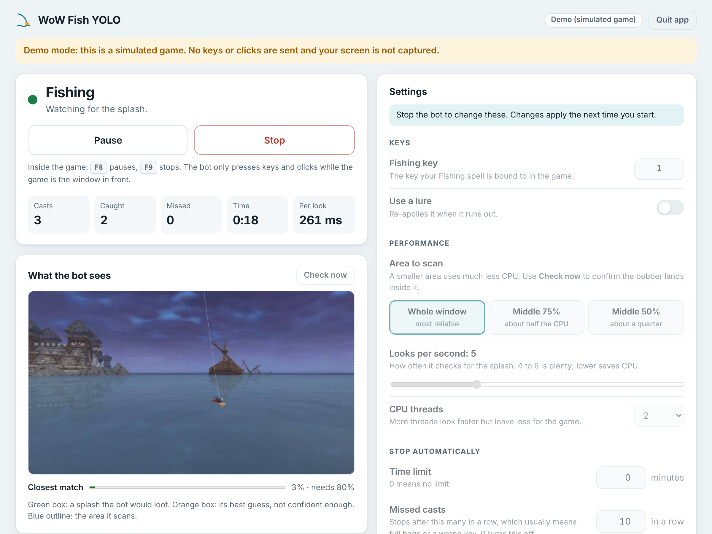

# WoW_fish_YOLO

WoW_fish_YOLO is a fishing bot for World of Warcraft. It watches the game window with a small YOLO vision model and
loots when it sees the bobber splash. The model was trained on 2800 screenshots from different regions of the game
in the Cataclysm version.

This is a fork of [Hester60/WoW_fish_YOLO](https://github.com/Hester60/WoW_fish_YOLO). It adds a control page in
your browser, runs on Windows and macOS, and needs far less memory and disk. See
[Changes in this fork](#changes-in-this-fork).

> Automating gameplay is against Blizzard's terms of service and can get an account closed. Use at your own risk.

## Requirements

- Windows 10 or 11, or a recent macOS (14 or newer recommended)
- Python 3.11 or newer (64-bit)
- About 350 MB of disk

## Start

**Windows:** double-click `start.bat`.

**macOS:** double-click `start.command`. If macOS refuses to open it, right-click it and choose Open, or run
`bash start.command` in Terminal.

The first run creates a private Python environment in `.venv` and installs the requirements, which takes a few
minutes. After that the control page opens in your browser. Leave the console window open while you fish.

To set it up by hand instead:

```
python -m venv .venv
.venv\Scripts\activate          (macOS: source .venv/bin/activate)
pip install -r requirements.txt
python bot.py
```

## In the game

1. Turn on **Auto Loot** in the game's settings.
2. Run the game in Windowed or Windowed (Fullscreen) mode.
3. The model was trained in first-person view with the interface hidden. For good results:
    - Zoom in to first-person view and face open water.
    - Hide the interface (ALT + Z or ALT + W depending on your game configuration).

The setup should look like this:


## The control page



*The control page, shown here in demo mode with the simulated game.*

1. Click the **Fishing key** button and press the key your Fishing spell is bound to.
2. Press **Check now**. The game comes to the front for a moment and a picture of what the bot sees appears on the
   page. The bobber should be inside the outlined area.
3. Press **Start fishing**.

| Control | Effect |
|---|---|
| `F8` in the game | Pause / resume |
| `F9` in the game | Stop |
| Pause and Stop on the page | The same |
| Mouse into a screen corner | Stop (pyautogui fail-safe) |

The bot only sends keys and clicks while the game is the window in front. If you switch to another application it
waits, and carries on when you come back to the game. `F8` and `F9` can be changed under Advanced.

Settings are saved as you change them and can be changed while the bot is stopped:

| Setting | What it does |
|---|---|
| Fishing key, lure key, lure duration | The keys to press. The lure is re-applied when it runs out. |
| Area to scan | Whole window, or only the middle 75% or 50%. A smaller area needs much less CPU. |
| Looks per second | How often it checks for the splash. 4 to 6 is plenty. |
| CPU threads | Threads used by the detector. |
| Time limit, missed casts | Stop after a number of minutes, or after several casts in a row that catch nothing. |
| Cast time, confidence | Under Advanced. The defaults are the tested values. |

### macOS permissions

macOS asks for these the first time; they are under System Settings > Privacy & Security. Grant them to the
application you start the bot from (Terminal, for example), then start the bot again.

- **Screen Recording**, so the bot can see the game. Without it the preview is black.
- **Accessibility**, so it can press keys and click.
- **Input Monitoring**, if `F8`/`F9` do nothing. The buttons on the page work either way.

## Using less CPU and memory

Detection runs on ONNX Runtime, not PyTorch, and the bot looks a few times a second instead of as fast as it can.
Measured on a 4-core Linux machine against the original version:

| | Original | This fork |
|---|---|---|
| Memory | about 1025 MB | about 300 MB |
| CPU while waiting for a bite | about 3.0 cores | about 1.3 cores (whole window), 0.9 (middle 75%), 0.5 (middle 50%) |
| Loading the model | 8 s | 0.3 s |
| One look at the whole window | 234 ms on 4 cores | about 240 ms on 2 cores |
| Install size | 1.8 GB (per the original README) | about 320 MB |
| Model file | 99 MB | 50 MB |

That machine has a slow server CPU; a desktop CPU does each look faster, which lowers the CPU share further
because the bot only looks five times a second.

To lower CPU use further, choose a smaller **Area to scan**, fewer **Looks per second** or fewer **CPU threads**.
A smaller area keeps the bobber at the size the model was trained on, but the bobber has to land inside it, so use
**Check now** to confirm.

## Assistant (optional)

The page has an assistant that runs on a language model on your own computer. It can explain settings, help with
problems and suggest setting changes from a plain description such as "fishing is on 1, my lure is on 2 and lasts
10 minutes". It is off by default.

1. Install [Ollama](https://ollama.com) and download a model: `ollama pull qwen3:8b` (about 5 GB).
2. On the page, switch the assistant on and press **Test connection**.

Any server with an OpenAI-compatible API works: for LM Studio use `http://localhost:1234/v1` and the name of the
model you loaded. Smaller models such as `qwen3:4b` answer faster on a modest computer.

What it does and does not do:

- It receives your settings, the session's numbers and the last lines of the activity log. It cannot see the screen.
- It can only suggest. Suggestions go through the same checks as the form and nothing changes until you press Apply.
- It is not involved in fishing. A language model is far too slow and heavy to watch the screen several times a
  second, so detection stays with the small vision model.
- Nothing is sent anywhere except the server address you set.

## Without the page

```
python bot.py --console --fishing-key f        fish from the console, stop with CTRL+C
python bot.py --demo                            try the page against a simulated game
python bot.py --help                            all options
```

Demo mode sends no keys or clicks and does not capture your screen. Its "splash" is a synthetic picture made to
trigger the detector, not a real screenshot.

## Tests

```
pip install pytest
pytest tests
```

The tests use a simulated game and the real model, so they run on any system. On Windows and macOS they also check
that the system-specific parts load and answer. `.github/workflows/tests.yml` runs them on Windows, macOS and Linux
for every push once GitHub Actions is enabled for the repository.

## What has and has not been verified

- Verified on Linux: the fishing loop, settings, the control page in a real browser, and that the ONNX model gives
  the same results as the original PyTorch model (scores within 0.00002).
- Not yet run on real hardware: the Windows and macOS parts (finding the window, pressing keys, capturing the
  screen). They are written against the documented system APIs, so do a short supervised run first and use
  **Check now** to confirm the bot sees the game.
- Not tested with a real language model: the assistant is tested against a stand-in server that speaks the same API.
- No real splash screenshots ship with the repository, so accuracy with the smaller scan areas is unmeasured.

## Project layout

| Path | Contents |
|---|---|
| `bot.py` | Entry point |
| `fishbot/engine.py` | The fishing loop |
| `fishbot/detector.py`, `fishbot/vision.py` | Detection and screen capture |
| `fishbot/platforms/` | The Windows, macOS and demo parts |
| `fishbot/service.py`, `fishbot/server.py`, `fishbot/web/` | The control page |
| `fishbot/assistant.py` | The local-LLM assistant |
| `models/splash.onnx` | The detection model |
| `tools/` | Scripts that rebuild the model and the demo picture from the original `best.pt` |

`best.pt`, the original PyTorch checkpoint, is no longer in the repository; it is in the upstream one.
`tools/export_onnx.py` converts it and checks the result against it.

## Changes in this fork

- Runs on Windows and macOS, with a control page in the browser.
- Detection uses ONNX Runtime: about a third of the memory, under a fifth of the install size and less than half
  the CPU. Optional smaller scan areas cut the work per look by up to four times.
- The bot no longer crashes after 333 casts. The cast loop called itself and ran into Python's recursion limit.
- `F8` pauses and `F9` stops the bot from inside the game. Before, the only way out was CTRL+C in the console.
- Keys and clicks are never sent to another application, and the bot no longer pulls the game back to the front on
  every cast.
- The game window is identified by its exact title and its process, and the captured area is read on every look,
  so maximized, windowed and moved windows work.
- It can stop by itself after a time limit or after several casts in a row that catch nothing.
- Settings are validated and saved between runs.
- An optional assistant that runs on a local language model.

## Improvements

- Training: The bot reliably finds the fish 99% of the time in the original author's setup, but there is room for
  improvement. For example, additional training with screenshots from different regions could enhance accuracy.
- Model size: a nano-sized model trained on the same data would be a few MB and several times faster still.
- Packaging: a single downloadable app per system, so Python does not have to be installed.
